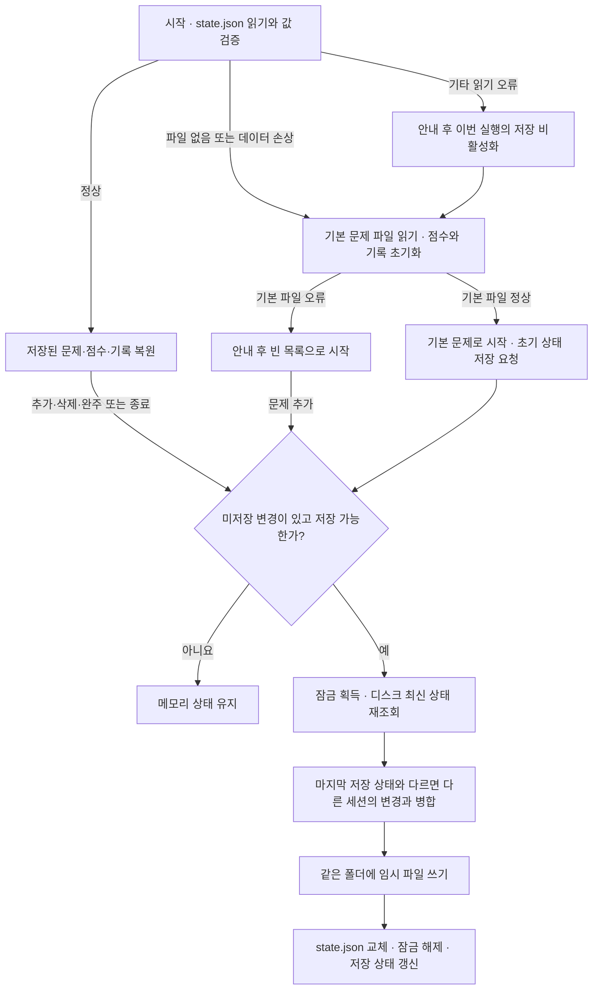

# Quiz Game

## 프로젝트 개요

- 터미널에서 네 개의 선택지 중 정답을 고르는 Python 게임
- 한 판에 풀 문제 수를 정하고, 모르는 문제에서는 힌트를 열 수 있음
- 직접 등록한 문제와 플레이 기록은 다음 실행에서도 이어짐

[코드 설계](#코드-구조와-설계-이유) · [요구사항별 수정 위치](#요구사항이-바뀔-때-수정할-곳) · [데이터 저장과 복구](#데이터-파일) · [동시 저장 테스트](#동시-저장-검증) · [Git 이력](#git-저장소)

## 퀴즈 주제

- AI 에이전트, AI 기반 소프트웨어 개발, 로봇 시뮬레이션, 프로그래머블 머니, 양자 컴퓨팅을 한 문제씩 다룸
- 낯선 기술 용어를 실제 쓰임과 연결해 익힐 수 있도록 작동 원리나 적용 사례를 고르는 문제로 구성

## 실행 방법

- Python 3.10 이상과 표준 라이브러리 사용
- 프로젝트 폴더에서 Python 버전을 확인한 뒤 게임 실행

```sh
python --version
python quiz_game.py
```

- 같은 폴더에서 `python -m unittest -v`로 테스트 실행
- 테스트용 게임 데이터는 임시 폴더에 생성
- 첫 실행 후 메뉴 `3`을 선택하면 `등록된 퀴즈 목록 (총 5개)`로 기본 문항 수 확인. 정상 저장 파일로 다시 시작하면 추가·삭제가 반영된 개수를 자동으로 표시
- 기본 문항만 검사하려면 프로젝트 폴더의 Python에서 아래 예시 실행. `decode_quizzes()`가 각 문제의 선택지 네 개와 정답 범위를 검증하며, 현재 배포본의 출력은 `기본 퀴즈 5개`

```python
from quiz_game import SEED_FILE
from quiz_storage import decode_quizzes, read_json

quizzes = decode_quizzes(read_json(SEED_FILE))
print(f"기본 퀴즈 {len(quizzes)}개")
```

## 기능 목록

- 메뉴에서 현재 문제 수는 `3`, 점수와 기록은 `4`로 확인. 풀이 중 `h`는 힌트, 삭제할 문제를 고를 때 `0`은 취소

- **1. 퀴즈 풀기**

  - 선택 직후 `풀 문제 수 (1~5):`처럼 현재 풀 수 있는 범위 표시. 원하는 문제 수를 고르면 한 판에서 중복 없이 무작위로 출제
  - `1`~`4` 중 하나로 답하면 정답을 바로 확인할 수 있음

- **2. 퀴즈 추가**

  - 문제, 선택지 네 개, 정답 번호, 힌트를 차례로 입력
  - 힌트는 `Enter`로 건너뛸 수 있으며 등록을 마치면 즉시 저장

- **3. 퀴즈 목록**

  - 등록 순서대로 문제 번호와 내용 확인
  - 문제를 모두 삭제하면 다음 실행에서도 빈 목록 유지

- **4. 최고 점수와 플레이 기록**

  - 최고 점수와 모든 완주 기록 확인
  - 회차별 완료 시각, 문제 수, 정답 수, 힌트 사용 수, 점수를 최근 순으로 조회
  - 첫 완주 전에는 플레이 기록이 없다는 안내 표시

- **5. 종료**

  - 저장하지 못한 변경이 있으면 저장을 다시 시도한 뒤 종료

- **6. 퀴즈 삭제**

  - 목록에서 문제 번호를 고르면 해당 문제를 삭제하고 즉시 저장
  - `0`을 입력하면 삭제 취소

### 힌트와 점수

- 정답 하나당 2점
- `h` 또는 `힌트`로 힌트를 열면 해당 문제에서 한 번만 1점 차감
- 등록된 힌트가 없는 문제는 힌트를 요청해도 점수 차감 없음
- 합계의 최솟값은 0점이며, 합계를 만점으로 나눠 100을 곱한 뒤 Python의 `round`로 반올림
- 두 문제를 모두 맞히고 한 문제에서 힌트를 쓰면 4점 만점에 3점, 최종 75점

### 입력과 중단 처리

- 숫자 입력은 앞뒤 공백을 제거한 뒤 검사
- 메뉴에 빈 입력, `abc`, `9`를 넣으면 `1~6 사이의 숫자를 입력해 주세요.`가 표시됨. 같은 프롬프트에 `3`을 입력하면 목록 조회
- 정답 번호에 `0`을 넣으면 `1~4 사이의 숫자를 입력해 주세요.`가 표시됨. 예를 들어 두 번째 선택지는 `2`로 입력
- 문제·선택지가 공백이면 `내용을 한 글자 이상 입력해 주세요.`가 표시되고 해당 항목을 다시 입력
- `Ctrl+C`나 입력 종료(EOF)로 중단하면 작성 중인 문제와 미완주 회차는 기록에서 제외
- 메뉴 `5`로 종료하거나 입력이 중단되면 `main()`이 마지막으로 `save_state()`를 한 번 호출. 저장할 변경(`dirty`)이 있고 쓰기가 허용된 경우(`can_save`)에만 디스크에 반영
- 직전 쓰기가 실패한 변경은 다음 추가·삭제·완주 또는 종료 시 재시도. 마지막 저장도 실패하거나 그때 다시 `Ctrl+C`를 누르면 안내 후 종료되며 미저장 변경은 메모리와 함께 사라짐

## 파일 구조

```text
Python_Git/
├── quiz_game.py       # 실행 진입점과 QuizGame 클래스, 메뉴 및 게임 진행
├── quiz.py            # Quiz 클래스, 선택지 출력과 정답 판정
├── quiz_storage.py    # JSON 검증, 동시 변경 병합과 파일 저장
├── quiz_list.json     # 첫 실행과 복구에 쓰는 기본 문제 5개
├── state.json         # 실행하면 생성되는 개인 퀴즈와 점수
├── test_quiz_game.py  # 콘솔과 저장 동작을 검증하는 unittest 테스트
├── docs/screenshots/  # 실행 환경과 게임 화면
├── .gitignore         # 개인 상태, 잠금·임시 파일과 Python 캐시 제외
└── README.md
```

## 코드 구조 및 설계

### 객체지향

- **`Quiz`는 문제 한 개를 표현하는 데이터 클래스.** 문제, 선택지, 정답 번호, 힌트가 한 객체에 속하므로 같은 문제를 출력하고 채점할 때 같은 선택지와 정답을 사용. `from_dict()`는 저장 항목 검증·변환, `display()`는 번호가 붙은 선택지 출력, `check_answer()`는 선택 번호의 정답 여부 반환
- **`QuizGame`은 한 실행의 상태와 진행을 담당.** `show_menu()`·`start()`는 메뉴 표시·선택, `play()`·`ask_question()`은 출제·응답, `finish_round()`·`show_scores()`는 완주 기록·점수 조회를 담당. `add_quiz()`·`delete_quiz()`·`list_quizzes()`는 같은 목록을 사용하고, `load_state()`·`save_state()`는 그 세션의 저장 상태를 관리
- **함수만으로 구현할 때의 장단점.** 한 번의 정답 판정처럼 입력과 반환값이 분명한 작업은 직접 호출하고 테스트하기 쉬움. 메뉴 전체를 함수로 연결하면 문제 목록, 최고 점수, 기록, 마지막 저장 상태를 호출마다 전달하고 돌려받아야 함
- **클래스를 사용할 때의 장단점.** 세션마다 `QuizGame(state_file)` 하나로 관련 상태를 묶고 두 세션을 독립적으로 생성할 수 있음. 반면 메서드의 결과가 이전 호출에 의존하므로 재시작·저장 테스트에서는 임시 경로와 새 인스턴스로 시작 상태를 구성

### 입력 검증과 파일 입출력의 경계

- `Quiz.check_answer()`, `decode_state()`, `validate_record()`는 문제와 입력값만으로 판정·검증하는 순수 로직. 터미널이나 파일 없이 결과 또는 예외를 테스트할 수 있음
- `quiz_game.py`의 `parse_number()`는 공백 제거·정수 변환·범위 검사와 **실패 메시지 출력**까지 담당. 실제 키보드 입력과 재입력 반복은 `read_number()`·`read_text()`가 담당
- `quiz_storage.py`의 `read_json()`·`write_json()`은 파일을 열고 읽거나 교체하는 입출력, `save_changes()`는 잠금과 병합을 담당. `QuizGame`은 언제 저장할지와 오류 발생 시 사용자에게 보여 줄 안내를 결정

### 요구사항이 바뀔 때 수정할 곳

| 바뀌는 요구사항 | 수정 파일과 주요 메서드·함수 | 함께 확인할 동작 |
| --- | --- | --- |
| 메뉴 번호·입력 규칙 | `quiz_game.py`의 `QuizGame.show_menu()`, `start()`, `parse_number()`, `read_number()` | 화면 번호, 허용 범위, 선택 후 동작, 잘못된 입력의 재입력 흐름 |
| 기본 문제·선택지 수 | 문항 내용은 `quiz_list.json`. 선택지 수 변경은 `quiz.py`의 `Quiz.from_dict()`, `quiz_game.py`의 `QuizGame.add_quiz()`·`ask_question()` | 정답 번호와 입력 범위, 기존 4지선다 저장 파일 호환 |
| 출제 순서·힌트·배점 | `quiz_game.py`의 `QuizGame.play()`, `ask_question()`, `finish_round()` | 중복 출제 여부, 같은 힌트 반복 시 차감 횟수, 0점·최고 점수 처리 |
| 기록 필드·점수 화면 | `quiz_game.py`의 `QuizGame.finish_round()`·`show_scores()`, `quiz_storage.py`의 `validate_record()`·`decode_state()`·`encode_state()` | 새 필드의 검증·출력, 해당 필드가 없는 기존 파일 읽기 |
| 저장 위치·백업·동시 저장 | `quiz_game.py`의 `STATE_FILE`과 `QuizGame.load_state()`·`save_state()`, `quiz_storage.py`의 `save_changes()`, `lock_state()`, `merge_changes()`, `write_json()` | 개인 파일의 Git 제외 규칙, 손상 복구, 쓰기 실패 후 재시도, 다른 세션의 기록 보존 |

- 각 변경은 `test_quiz_game.py`의 해당 사례와 함께 검증. 배점 변경은 `test_hint_cost_best_and_history_across_restarts`, 저장 변경은 `test_interrupted_write_preserves_previous_file_and_can_retry`가 대표 사례

## 데이터 파일

- `state.json`은 `quiz_game.py`와 같은 폴더에 UTF-8로 저장
- UTF-8 : 유니코드 문자를 표현하기 위한 가변 길이 문자 인코딩 방식
  - 각 문자는 1~4바이트로 표현되며, ASCII와 완벽히 호환됨
  - ASCII의 0~127 범위의 문자는 UTF-8에서도 동일하게 표현되므로 기존 ASCII 기반 시스템과의 호환성이 좋음

- 첫 실행이나 JSON 손상 시 `quiz_list.json`에서 기본 문제를 불러오고 최고 점수와 플레이 기록 초기화
- 저장 파일을 읽을 권한이 없으면 안내 후 메모리에서 플레이 가능

### JSON 장단점
- **JSON(JavaScript Object Notation)**
  - JavaScript에서 출발하여 JavaScript의 구문 형식을 따르지만 프로그래밍 언어와 플랫폼에 독립적

**장점**

- 텍스트 형식이므로 사람이 편집기로 열어 문제와 점수를 쉽게 읽을 수 있음
- 언어와 플랫폼에 독립적이므로 서로 다른 시스템 간에 객체 데이터를 교환하기 쉬움
- 대부분의 최신 웹 브라우저에 JSON 파서가 내장되어 있어 `JSON.parse()`로 데이터를 읽을 수 있음
- XML의 여닫는 태그보다 간결하게 표현할 수 있어 같은 데이터의 전송량을 줄일 수 있음. 처리 속도는 데이터 구조와 파서에 따라 달라짐

**단점**

- 따옴표나 쉼표 하나만 잘못 써도 문서 전체를 읽는 데 실패할 수 있음
- 표준 JSON은 주석을 지원하지 않아 필드의 의미를 별도 문서로 설명해야 할 수 있음
- 필드별 데이터 타입을 강제하지 않아 수신 시 검증이 필요함. 이 게임은 `decode_state()`로 검증하며, 시스템 간 교환에는 JSON Schema도 활용 가능
- 큰 JSON 문서를 통째로 주고받거나 파싱하면 전송 시간과 메모리 사용량이 늘어남. 이 게임처럼 모든 기록을 `state.json` 한 파일에 저장할 때의 한계는 다음과 같음

  - **읽기·쓰기** — 회차 하나를 추가해도 파일 전체를 다시 읽고 검증한 뒤 다시 씀. 파일 크기가 `B`바이트이면 회차 한 건을 추가하는 파일 입출력 비용은 `O(B)`
  - **메모리·디스크** — 시작할 때 모든 문제와 기록을 메모리에 올리므로 기록이 쌓일수록 로딩 시간이 길어짐. 저장 중에는 병합을 위한 상태 사본도 메모리에 보관하고, 디스크에는 교체가 끝날 때까지 기존 파일과 임시 파일이 함께 존재
  - **검색·동시 저장** — 특정 날짜의 기록을 찾으려면 배열을 순회해야 하고, 여러 세션이 동시에 저장하면 쓰기 잠금을 차례로 기다림. 조회·저장 지연이 커지면 SQLite에서 회차별로 행을 추가하고 완료 시각에 인덱스를 두는 방법을 고려할 수 있음

- 날짜·시간 전용 타입이 없어 이 게임은 완료 시각을 UTC 오프셋이 포함된 ISO 8601 문자열로 저장
  - ISO 8601 문자열: 날짜와 시간을 정해진 순서로 적은 텍스트
    - ex) 2026-11-22T12:12:15+00:00

| 부분 | 뜻 |
| --- | --- |
| `2026-11-22` | 2026년 11월 22일 |
| `T` | 날짜와 시간을 구분하는 문자 |
| `12:12:15` | 12시 12분 15초 |
| `+00:00` | UTC와의 시차가 0시간 |


**게임의 데이터 구조**

- `quizzes`는 문제·선택지·정답·힌트를 문항별로 묶어 `Quiz`로 변환하기 쉬움
- `history`는 완주 당시의 집계값을 보존하므로 문제를 삭제해도 과거 점수가 유지됨. 개별 오답을 조회하려면 문항별 응답 기록이 추가로 필요

| 필드 | 형식과 의미 |
| --- | --- |
| `quizzes` | 등록 순서대로 저장한 문제 배열(빈 배열 `[]` 허용) |
| `quizzes[].question`, `choices` | 문제 문자열과 비어 있지 않은 선택지 문자열 네 개 |
| `quizzes[].answer`, `hint` | 1~4 사이의 정답 번호와 힌트 문자열(힌트가 없으면 `""`) |
| `best_score` | 첫 완주 전에는 `null`, 이후에는 완주한 게임의 최고 점수(0~100점) |
| `history[].played_at` | 완료 시각을 현지 시각과 UTC 오프셋으로 기록한 ISO 8601 문자열 |
| `history[].total`, `correct`, `hints_used`, `score` | 해당 회차의 문제 수, 정답 수, 힌트를 연 문제 수, 100점 환산 점수 |

- 완주한 순서대로 `history` 배열 끝에 회차 기록 추가
- 같은 폴더의 임시 파일에 쓰기를 마친 뒤 `state.json` 교체
- 여러 터미널에서 동시에 저장할 때는 `.state.lock`으로 쓰기 순서를 조정해 각 실행에서 추가한 문제와 점수 보존

### 읽기·쓰기 순서



- 저장 직전 파일이 없거나 손상됐으면 `last_saved`를 비교 기준으로 사용. 다른 세션의 정상 변경이 있으면 문제의 추가·삭제분과 새 회차를 합치고 더 높은 최고 점수를 보존

### 오류별 대응과 백업 복원

| 터미널 안내 | 가능한 원인 | 사용자 조치 |
| --- | --- | --- |
| `저장 파일을 읽을 수 없습니다.` | 읽기 권한 부족, `state.json` 경로가 디렉터리인 경우 | 파일 종류와 읽기 권한 확인. 이 실행은 메모리 전용이므로 문제를 해결한 뒤 다시 실행 |
| `저장하지 못했습니다.` | 디스크 공간 부족, 프로젝트 폴더나 잠금 파일에 대한 쓰기 권한 부족 | 같은 세션에서 공간과 권한을 확보한 뒤 다음 변경 또는 종료 시 재시도. 임시 파일 교체에 실패하면 직전 저장본 유지 |
| `저장 데이터가 손상되었습니다.` | 잘못된 UTF-8·JSON, 정답 번호나 기록 필드가 범위를 벗어남 | 기본 문제와 빈 기록으로 복구. 기존 플레이 기록이 필요하면 아래 절차로 사고 이전 정상본 복원 |
| `기본 퀴즈를 읽을 수 없습니다.` | `quiz_list.json` 누락 또는 형식 오류 | 빈 목록으로 시작하므로 저장소의 기본 파일과 대조해 복구하고 다시 실행 |

- **자동 보존 정책.** 손상 원본의 자동 백업과 복구 로그 파일은 각각 0개이며 자동 보관 경로·기간은 없음. 복구 안내는 터미널에 출력되고, 기본값 저장이 성공하면 기존 `state.json`이 교체됨
- **수동 보관 예시.** 정상 종료 후 저장소 밖 `../Python_Git-backups/`에 `state-<UTC시각>.json`으로 복사. 손상본과 복구 기록도 같은 폴더에 보관할 수 있음. 보관 기간 예시는 30일이며 직접 정리하고, 마지막으로 검증한 정상본은 다음 정상본을 확인할 때까지 보관

1. 손상이 의심되면 재실행 전에 현재 파일을 `damaged-<UTC시각>.json`으로 복사해 원본을 확보
2. 실행 중인 게임을 모두 종료한 뒤 사고 이전 백업을 선택. 프로젝트 폴더의 Python에서 아래처럼 검사해 문항 수·최고 점수·기록 수 확인
3. 검증을 통과한 백업을 프로젝트 루트의 `state.json`으로 복사. 재실행 후 메뉴 `3`·`4`에서 확인하고 복구 시각, 오류 문구, 사용한 백업 이름과 결과를 `recovery-<UTC시각>.log`에 수동 기록

```python
from pathlib import Path
from quiz_storage import decode_state, read_json

backup = Path("../Python_Git-backups/state-20261122T120000Z.json")  # 선택한 백업 경로
quizzes, best, history = decode_state(read_json(backup))
print(f"문제 {len(quizzes)}개, 최고 점수 {best}, 기록 {len(history)}회")
```

## 동시 저장 검증

- 기존 단위 테스트는 두 세션이 같은 상태를 읽은 뒤 한쪽에서 문제를 추가하고 다른 쪽에서 기존 문제를 삭제하는 상황을 재현. 최종 문제 목록, 두 회차의 점수 `[100, 0]`, 최고 점수 `100`을 확인
- 실행 명령은 `python -m unittest -v test_quiz_game.QuizGameTests.test_two_sessions_keep_each_others_questions_and_scores`
- 아래 추가 테스트는 임시 폴더에서 두 세션을 각각 다른 스레드로 실행. 둘 다 읽기를 끝낸 시점에 함께 완주시키고, 저장 순서와 관계없이 **0점과 100점이 한 번씩** 남는지 검사. 프로젝트 루트에서 `python -m doctest README.md`로 실행

```pycon
>>> from concurrent.futures import ThreadPoolExecutor
>>> from contextlib import redirect_stdout
>>> from io import StringIO
>>> from pathlib import Path
>>> from tempfile import TemporaryDirectory
>>> from threading import Barrier
>>> from quiz_game import QuizGame
>>> from quiz_storage import read_json
>>> def finish(path, ready, correct):
...     game = QuizGame(path)
...     game.load_state()
...     ready.wait(timeout=10)
...     game.finish_round(1, correct, 0)
>>> with TemporaryDirectory() as folder, redirect_stdout(StringIO()):
...     path = Path(folder) / "state.json"
...     ready = Barrier(2)
...     with ThreadPoolExecutor(max_workers=2) as pool:
...         first = pool.submit(finish, path, ready, 1)
...         second = pool.submit(finish, path, ready, 0)
...         first.result()
...         second.result()
...     saved = read_json(path)
>>> sorted(row["score"] for row in saved["history"]), saved["best_score"]
([0, 100], 100)

```

## 실행 화면

- 아래 시각은 2026-11-22 UTC 기준 원본 터미널 로그 기록 시각

### 개발 환경 및 시작

12:12:20 · Python 3.10.20, Git 2.25.1과 작업 브랜치 `main` 확인. [Python·Git 설정](docs/screenshots/environment.png)

```text
Python_Git $ python --version
Python 3.10.20
Python_Git $ git --version
git version 2.25.1
Python_Git $ git rev-parse --show-toplevel
/root/Python_Git
Python_Git $ git branch --show-current
main
Python_Git $ git config --get user.name
eunhye0323
Python_Git $
```

12:12:18 · 기본 퀴즈를 불러온 뒤 번호 1~6 메뉴 표시. [첫 실행 메뉴](docs/screenshots/menu.png)

```text
Python_Git $ python quiz_game.py
첫 실행입니다. 기본 퀴즈를 불러옵니다.

Quiz Game | Menu
1. 퀴즈 풀기
2. 퀴즈 추가
3. 퀴즈 목록
4. 최고 점수와 플레이 기록
5. 종료
6. 퀴즈 삭제
메뉴 선택 (1~6):
```

### 문제 등록 및 조회

12:12:19 · 정답이 `git merge`인 문제를 등록해 총 6개로 증가. [퀴즈 추가](docs/screenshots/add_quiz.png)

```text
메뉴 선택 (1~6): 2

새 퀴즈 등록
문제: Git에서 두 브랜치의 변경을 합치는 명령은?
선택지 1: git clone
선택지 2: git status
선택지 3: git merge
선택지 4: git log
정답 번호 (1~4): 3
힌트 (없으면 Enter): 각 브랜치의 커밋을 하나의 이력으로 모읍니다.
퀴즈를 추가했습니다. 현재 6개입니다.
```

12:12:20 · 새 문제가 목록 6번에 표시됨. [추가 후 목록](docs/screenshots/list.png)

```text
메뉴 선택 (1~6): 3

등록된 퀴즈 목록 (총 6개)
  1. Agentic AI의 핵심 특징으로 가장 적절한 것은?
  2. 기존 AIDD(AI-Driven Development)와 비교한 AI-Native Software Engineering의 차이로 옳은 것은?
  3. Sim2Real에서 시뮬레이션과 현실 사이의 물리적 차이를 줄이기 위해 마찰·질량·조명 등 환경 조건을 무작위로 바꾸는 기법은?
  4. AI Agent 시대에 스테이블코인이 구현하는 핵심 금융 인프라로 기대되는 'Programmable money'의 정의로 옳은 것은?
  5. 양자 컴퓨팅 본격 상용화의 분기점이 될 것으로 전망되는 것은?
  6. Git에서 두 브랜치의 변경을 합치는 명령은?
```

### 힌트 사용 및 점수 유지

12:12:20 · 힌트 1회 사용 후 정답을 골라 50점 획득. [힌트를 사용한 풀이](docs/screenshots/play.png)

```text
메뉴 선택 (1~6): 1
풀 문제 수 (1~6): 1
정답은 2점, 힌트를 열면 문제당 한 번 1점 차감합니다. 결과는 100점으로 환산합니다.

[문제 1/1]
기존 AIDD(AI-Driven Development)와 비교한 AI-Native Software Engineering의 차이로 옳은 것은?
  1. 테스트 자동화 단계에만 AI를 적용한다
  2. 요구사항 정의부터 배포·운영까지 SDLC(Software Development Life Cycle) 전 과정을 포괄한다
  3. 개발자를 완전히 대체하는 것을 목표로 한다
  4. 설계 단계에서만 AI를 보조 도구로 사용한다
정답 번호 (1~4, h=힌트): h
힌트: 요구사항을 정하는 시점과 서비스를 운영하는 시점에 공통으로 적용할 수 있는지 살펴보세요.
정답 번호 (1~4, h=힌트): 2
정답입니다!

결과: 1문제 중 1문제 정답 · 힌트 1회 · 50점
새로운 최고 점수입니다!
```

12:12:20 · 게임을 다시 열어 최고 50점과 완주 기록 2회 확인. [재실행 후 최고 점수와 기록](docs/screenshots/score.png)

```text
메뉴 선택 (1~6): 4

최고 점수: 50점
플레이 기록 2회 (최근 순)
  2026-11-22 12:12:15+00:00 | 1문제 중 0문제 정답 | 힌트 0회 | 0점
  2026-11-22 12:12:15+00:00 | 1문제 중 1문제 정답 | 힌트 1회 | 50점
```

## Git 저장소

- 프로젝트의 GitHub 저장소 [eunhye0323/Python_Git](https://github.com/eunhye0323/Python_Git)

### Command
- `git rev-parse`
  - Git이 이해하는 revision, ref, 경로 관련 인자를 해석해서 스크립트나 사용자가 바로 쓸 수 있는 형태로 바꿔 주는 명령어
- `git rev-list` : 지정된 시작 지점부터 커밋 그래프를 순회하여 커밋 객체를 역시간 순서로 나열하고, 포함/제외 규칙과 선택적 필터를 적용
- `git add .` : **.gitignore 파일에 있는 파일들은 제외**하고 stage에 올림
- `git add *` : **.gitignore 파일에 있는 파일들도 포함**해 stage에 올림

### 커밋 단위와 메시지 규칙

- **커밋 단위**는 독립적으로 검증하거나 되돌릴 수 있는 변경 한 가지. 예를 들어 무작위 출제와 힌트 감점은 각각 한 커밋으로 작성. 같은 결함을 고치는 구현과 회귀 테스트는 함께 담을 수 있고, 관련 없는 문항·문서 수정은 별도 커밋으로 분리
- **메시지 형식**은 `유형: 변경 내용`. 유형 뒤에 콜론과 공백 하나를 쓰고, 한 줄 제목에 어떤 동작을 추가하거나 고쳤는지 한국어로 명시
- **유형**은 새 기능 `Feat`, 결함 수정 `Fix`, 테스트 `Test`, 문서 `Docs`, 기본 데이터 `Data`, 설정·정리 `Chore`, 브랜치 통합 `Merge` 사용
- **실제 예**는 `02452cb`의 `Feat: 문제별 힌트를 열고 최초 사용 한 번만 점수에서 차감`, `9b6a025`의 `Fix: 여러 실행에서 추가한 문제와 점수 기록을 저장할 때 함께 보존`

### 원격 저장소 커밋 수

- 2026-11-22 12:50:09 UTC에 갱신된 원격 추적 브랜치 `origin/main`의 스냅샷. `ada4647`까지의 **총 커밋 19개**에 병합 커밋 1개와 병합된 기능 커밋이 포함됨. 당시 `origin`의 모든 추적 브랜치에서 중복을 제외한 수도 19개
- 이후 브랜치가 이동해도 `git rev-list --count ada4647`로 같은 시점의 집계를 재현할 수 있음

```text
$ git rev-parse --short origin/main
ada4647
$ git rev-list --count origin/main
19
$ git rev-list --count --remotes=origin
19
$ git rev-list --count --merges origin/main
1
```

### 브랜치 분리와 병합

- `main`: 실행 가능한 게임과 검증·제출 문서를 모으는 기준 브랜치
- `feature/quiz-play`: 한 판의 무작위 출제·문제 수 선택과 힌트 채점을 개발한 브랜치. 같은 풀이 흐름을 바꾸는 두 작업을 기본 메뉴·저장 기능과 독립적으로 검토할 수 있도록 분리
- **병합 시 확인할 점**은 선택한 수만큼 중복 없이 출제되는지, 힌트를 반복해도 한 번만 차감되는지, 결과가 최고 점수·기록과 일치하는지임. 기능을 `main`에 `--no-ff`로 병합해 두 개발 경로가 합쳐진 지점을 `16239ed`로 남김

2026-11-22 12:15:22 UTC · 실습용 로컬 복제본에서 출제·힌트 커밋 두 개가 `16239ed`로 병합된 그래프를 캡처. [기능별 커밋과 브랜치 병합 그래프](docs/screenshots/git_graph.png)

```text
Python_Git $ git log --oneline --graph --decorate --all
* d94fdec (HEAD -> main, origin/main, origin/HEAD) Docs: 실행 방법과 점수·파일 구조를 설명하고 실제 터미널 화면 첨부
* 9b6a025 Fix: 여러 실행에서 추가한 문제와 점수 기록을 저장할 때 함께 보존
* 634ec50 Test: 콘솔 재실행, 빈 목록, 힌트 점수와 저장 실패 복구 검증
* abd9b4f Feat: 최고 점수와 모든 완주 기록을 시간·문제 수·힌트와 함께 저장 및 조회
* 0a98d0e Feat: 목록에서 퀴즈를 선택해 삭제하고 빈 목록도 그대로 저장
* 5ca0865 Feat: 문제와 선택지 네 개, 선택 힌트를 입력받아 즉시 저장
*   16239ed Merge: 무작위 퀴즈 풀이와 힌트 기능 통합
|\
| * 02452cb (origin/feature/quiz-play) Feat: 문제별 힌트를 열고 최초 사용 한 번만 점수에서 차감
| * 0a52d10 Feat: 원하는 수만큼 중복 없이 무작위로 출제하고 채점 결과 표시
|/
* ab417ed Feat: 프로젝트 루트의 UTF-8 상태 파일을 저장하고 누락·손상 시 복구
* 77b5ddc Feat: 반복 메뉴와 숫자 재입력, 저장된 문제 목록 화면 구현
* ec245ad Data: 퀴즈 5개의 선택지 수를 맞추고 정답 번호와 힌트 추가
* dfae016 Feat: 문제와 네 선택지의 검증·출력·정답 판정을 Quiz로 분리
* 9ca07fa Chore: 기존 퀴즈 초안과 문제 원본을 보존하고 실행 상태 파일 제외
* 7fdcc26 Initial commit
Python_Git $
```

### 로컬 복제와 동기화 실습

- 별도 로컬 저장소를 `clone`한 뒤 복제본에서 브랜치 병합 그래프를 추가하고 커밋
- 복제본에서 실습용 로컬 저장소로 커밋을 `push`
- 원래 폴더에서 `git pull --ff-only`로 해당 커밋을 가져옴
- 동기화 직후 두 폴더의 커밋이 모두 `31ca264`임을 확인

2026-11-22 12:16:08 UTC · 로컬 `pull --ff-only` 직후 양쪽에서 확인한 커밋은 모두 `31ca264`. [clone부터 pull까지의 터미널 기록](docs/screenshots/git_workflow.png)

```text
$ git clone --branch main practice.git Python_Git
Cloning into 'Python_Git'...
done.
$ git -C Python_Git add README.md docs/screenshots/git_graph.png
$ git -C Python_Git commit -m "Docs: 복제본에 브랜치 병합 그래프 추가"
[main 31ca264] Docs: 복제본에 브랜치 병합 그래프 추가
 2 files changed, 2 insertions(+)
 create mode 100644 docs/screenshots/git_graph.png
$ git -C Python_Git push origin main
Enumerating objects: 10, done.
Counting objects: 100% (10/10), done.
Delta compression using up to 64 threads
Compressing objects: 100% (5/5), done.
Writing objects: 100% (6/6), 165.94 KiB | 9.22 MiB/s, done.
Total 6 (delta 3), reused 0 (delta 0)
To /tmp/python-git-mission.b5iE4l/practice.git
   d94fdec..31ca264  main -> main
$ git -C /root/Python_Git pull --ff-only "$PWD/practice.git" main
remote: Enumerating objects: 10, done.
remote: Counting objects: 100% (10/10), done.
remote: Compressing objects: 100% (5/5), done.
remote: Total 6 (delta 3), reused 0 (delta 0)
Unpacking objects: 100% (6/6), 165.92 KiB | 13.83 MiB/s, done.
From /tmp/python-git-mission.b5iE4l/practice
 * branch            main       -> FETCH_HEAD
Updating d94fdec..31ca264
Fast-forward
 README.md                      |   2 ++
 docs/screenshots/git_graph.png | Bin 0 -> 173783 bytes
 2 files changed, 2 insertions(+)
 create mode 100644 docs/screenshots/git_graph.png
$ git -C Python_Git rev-parse --short HEAD
31ca264
$ git -C /root/Python_Git rev-parse --short HEAD
31ca264
$
```
